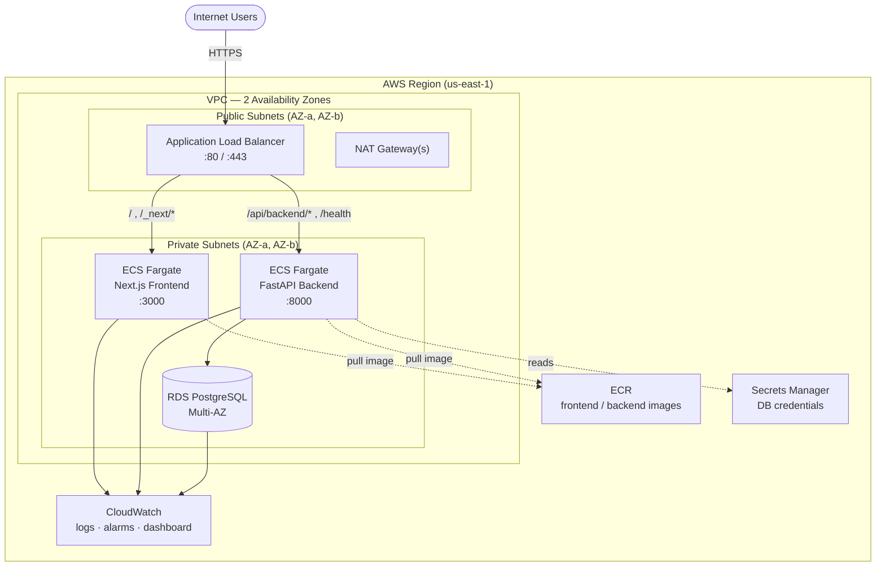
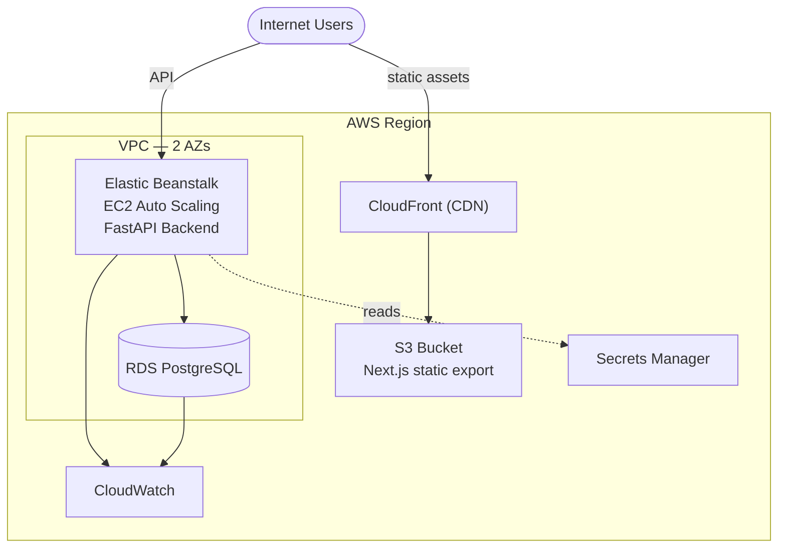
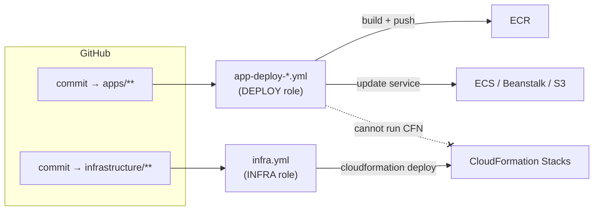

# Architecture Diagram

GitHub renders the Mermaid diagrams below directly.

## Containerized architecture (ECS Fargate)

## Non-containerized architecture (Elastic Beanstalk + S3/CloudFront)

## CI/CD — app vs infra separation

